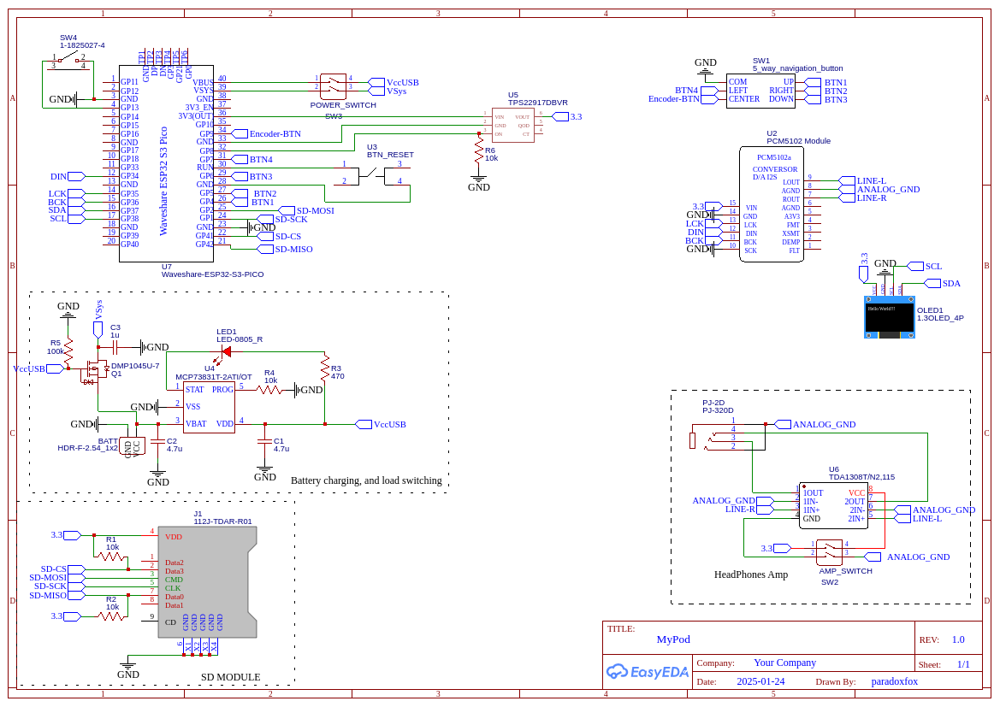

# MicroMyPod (WIP) 🎵

**MicroMyPod** is a lightweight, microcontroller-based mini MP3 player. Designed with portability and power efficiency in mind, this project aims to replicate the classic, nostalgic feel of early portable music players utilizing modern, easily accessible and cheap microcontroller boards. 

## ✨ Features

- **MP3 Playback:** Smooth decoding and playback of local `.mp3` audio files from SD card.
- **WebRadio:** After connecting to wifi, you can play your favouirite radio stations.
- **Bluetooth Input:** In the era, of phones without headphone jack this player can function as an easy way to connect your favourite wired headphones to your phone.
- **Bluetooth Output:** You can connect your bt headphones to this player.
- **Standalone Operation:** Fully functions offline as an independent music player with battery charged through USB-C cable.

## ⚠️ What isn't still working?
 - Bluetooth
 - there are some bugs with WebRadio
 - Preamp has not enough voltage to operate propperly
 - Deep sleep

## 🛠️ Hardware 
Currently this project is still WIP, and because of some issues connected to certain boards, and how much different crucial libraries  support them, I switch between ESP32S3 pico and Rpi Pico 2W boards. Because of that recreating this project is not the easiest task at this point, and next update may bring breaking changes to one of those platforms. 

